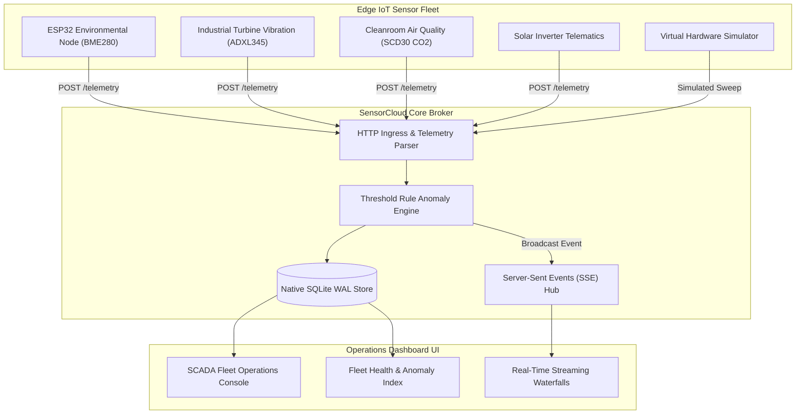

# SensorCloud — Industrial IoT Telemetry Dashboard & Stream Broker

[](https://github.com/Soulofghost/sensorcloud/actions)
[](LICENSE)
[](https://nodejs.org/)
[](https://nodejs.org/api/sqlite.html)
[]()

> **SensorCloud** is an industrial IoT sensor telemetry dashboard, streaming ingestion broker, and virtual hardware simulation studio. Engineered on Node.js 22 with zero external NPM runtime dependencies, it provides real-time Server-Sent Events (SSE) telemetry streaming, dynamic threshold rule anomaly detection, ESP32 hardware fleet management, and an interactive SCADA-style operations console.

---

## 1. Problem Statement

Industrial facilities and smart infrastructure operators struggle with high-frequency telemetry ingestion:
- **Telemetry Ingestion Bottlenecks:** Hundreds of microcontrollers (ESP32, STM32, Raspberry Pi Pico) transmitting continuous sensor packets overwhelm traditional REST backends that lack streaming pipelines.
- **Delayed Anomaly Detection:** When critical industrial assets (turbines, cleanroom HVACs, solar arrays) experience thermal spikes or mechanical vibration anomalies, alerts are often delayed by batch-oriented database polling.
- **Hardware Dependency in Testing:** Developing IoT monitoring consoles usually requires physical hardware setups, impeding automated CI/CD testing and developer onboarding.
- **Dependency Vulnerability & Maintenance:** Many IoT gateways pull in heavyweight message broker frameworks and deep NPM dependency trees that expand vulnerability attack surfaces.

---

## 2. Core Value Proposition

SensorCloud solves these challenges with a lean, deterministic, resilient platform:
- **Zero External NPM Runtime Dependencies:** Built strictly using native Node.js core modules (`node:http`, `node:sqlite`, `node:crypto`, `node:test`) for instant startup and negligible memory footprint.
- **Real-Time Streaming Over SSE:** Delivers sub-10ms telemetry updates directly to browser consoles using native Server-Sent Events without external broker daemons.
- **Autonomous Anomaly & Threshold Engine:** Evaluates incoming metrics against user-defined threshold rules (`GREATER_THAN`, `LESS_THAN`, `EQUALS`) in memory and logs alerts instantly.
- **Embedded Virtual ESP32 Hardware Simulator:** Simulates environmental sensors, vibration accelerometers, cleanroom air quality monitors, and solar microinverters on demand or on automated intervals.
- **Industrial Fleet Console:** Single-page operations hub featuring node status cards, live streaming telemetry waterfalls, and alert event feeds.

---

## 3. System Architecture

The following diagram illustrates how telemetry flows from edge microcontrollers or the virtual simulator into SensorCloud:



---

## 4. Telemetry Ingestion Broker & SSE Streaming

SensorCloud implements a dual-mode ingestion architecture:
1. **REST Ingress (`POST /api/v1/telemetry`):** Microcontrollers and edge gateways transmit individual or batch JSON readings.
2. **Server-Sent Events (`GET /api/v1/telemetry/stream`):** Browser clients maintain an open HTTP connection receiving immediate push updates upon ingestion without polling overhead.

---

## 5. Dynamic Threshold Rule Engine

Rules can be configured per device type or globally (`ANY`):
- **Condition Operators:** `GREATER_THAN`, `LESS_THAN`, `EQUALS`.
- **Severity Levels:** `CRITICAL`, `WARNING`, `INFO`.
- **Anomaly Detection:** When a metric breaches a rule threshold, SensorCloud flags the telemetry record (`is_anomaly = 1`) and registers a persistent alert event in `alert_events`.

---

## 6. Virtual ESP32 Hardware Simulator

SensorCloud includes a virtual hardware simulation engine that replicates real-world industrial sensors:
- **`ESP32-ENV-01` (Environmental):** Emulates ambient temperature (°C), relative humidity (%), and barometric pressure (hPa).
- **`ESP32-VIB-02` (Vibration):** Emulates mechanical RMS vibration (mm/s) and bearing casing temperature (°C).
- **`ESP32-AIR-03` (Air Quality):** Emulates carbon dioxide concentration (ppm) and PM2.5 particulate matter ($\mu\text{g/m}^3$).
- **`ESP32-PWR-04` (Power):** Emulates inverter power output (W) and grid AC voltage (V).

The simulator supports automated streaming loops and one-click anomaly injection to verify alerting systems in CI/CD without physical hardware.

---

## 7. Technology Stack

- **Runtime:** Node.js 22.0.0+ (LTS)
- **HTTP Engine:** Native `node:http` with Server-Sent Events (SSE)
- **Database:** Native `node:sqlite` (DatabaseSync) with WAL journal mode
- **Test Framework:** Native `node:test` and `node:assert`
- **Frontend:** Vanilla HTML5, CSS Custom Properties, Syne display typography, JetBrains Mono
- **Containerization:** Docker multi-stage Alpine build

---

## 8. REST & Streaming API Specification

### Device Management
- `GET /api/v1/devices` — List all provisioned edge nodes in the fleet.
- `POST /api/v1/devices` — Provision a new IoT hardware node.

### Telemetry & Ingestion
- `POST /api/v1/telemetry` — Ingest sensor telemetry measurement.
- `GET /api/v1/telemetry/history` — Query historical telemetry records with optional device and anomaly filters.
- `GET /api/v1/telemetry/stream` — SSE connection for real-time telemetry streaming.

### Threshold Rules & Alerts
- `GET /api/v1/rules` — List active alert rules.
- `POST /api/v1/rules` — Register a new threshold rule.
- `GET /api/v1/alerts` — Retrieve recent threshold breach events.

### Fleet Analytics & Simulation
- `GET /api/v1/analytics/summary` — Aggregate fleet metrics (active devices, total points, alert counts, fleet health score).
- `POST /api/v1/simulator/tick` — Trigger a simulated telemetry sweep across all active nodes.
- `GET /api/v1/health` — Broker health check probe.

---

## 9. Database Schema

```sql
CREATE TABLE devices (
  id TEXT PRIMARY KEY,
  name TEXT NOT NULL,
  device_type TEXT NOT NULL,
  model TEXT NOT NULL,
  location TEXT NOT NULL,
  status TEXT NOT NULL DEFAULT 'ACTIVE',
  battery_pct REAL NOT NULL DEFAULT 100.0,
  firmware_version TEXT NOT NULL DEFAULT 'v2.1.0-iot',
  created_at TEXT NOT NULL,
  last_seen_at TEXT
);

CREATE TABLE telemetry (
  id TEXT PRIMARY KEY,
  device_id TEXT NOT NULL,
  metric TEXT NOT NULL,
  value REAL NOT NULL,
  unit TEXT NOT NULL,
  is_anomaly INTEGER NOT NULL DEFAULT 0,
  created_at TEXT NOT NULL
);

CREATE TABLE alert_rules (
  id TEXT PRIMARY KEY,
  name TEXT NOT NULL,
  device_type TEXT NOT NULL,
  metric TEXT NOT NULL,
  condition TEXT NOT NULL,
  threshold_value REAL NOT NULL,
  severity TEXT NOT NULL,
  is_active INTEGER NOT NULL DEFAULT 1,
  created_at TEXT NOT NULL
);

CREATE TABLE alert_events (
  id TEXT PRIMARY KEY,
  rule_id TEXT NOT NULL,
  device_id TEXT NOT NULL,
  metric TEXT NOT NULL,
  value REAL NOT NULL,
  threshold_value REAL NOT NULL,
  message TEXT NOT NULL,
  created_at TEXT NOT NULL
);
```

---

## 10. Directory Structure

```text
sensorcloud/
├── .github/
│   └── workflows/
│       └── ci.yml               # Automated GitHub Actions test pipeline
├── backend/
│   ├── src/
│   │   ├── routes/
│   │   │   └── apiRoutes.js     # REST management endpoints
│   │   ├── services/
│   │   │   └── ruleEngine.js    # Anomaly and threshold evaluation
│   │   ├── simulator/
│   │   │   └── virtualEsp32.js  # Virtual hardware simulator
│   │   ├── database.js          # SQLite connection and migration schema
│   │   └── server.js            # HTTP ingress & SSE streaming server
│   ├── tests/
│   │   ├── api.test.js          # REST integration tests
│   │   ├── ruleEngine.test.js   # Rule evaluation unit tests
│   │   └── simulator.test.js    # Virtual hardware tests
│   ├── package.json
│   └── package-lock.json
├── frontend/
│   ├── index.html              # Industrial SCADA operations dashboard
│   ├── style.css               # Bespoke telemetry dark-mode styling
│   └── app.js                  # Frontend controller & SSE receiver
├── Dockerfile                  # Alpine container definition
├── docker-compose.yml          # Container orchestration
├── .env.example
├── .gitignore
├── LICENSE                     # MIT License
└── README.md
```

---

## 11. Getting Started

### Prerequisites
- Node.js 22.0.0 or higher
- Git

### Installation & Run
```bash
# Clone the repository
git clone https://github.com/Soulofghost/sensorcloud.git
cd sensorcloud/backend

# Install (creates lockfile if absent)
npm ci

# Start the Telemetry Broker
npm start
```
Access the Industrial Telemetry Dashboard at `http://localhost:8080`.

---

## 12. Automated Testing

SensorCloud includes a native test suite verifying rule evaluations, device provisioning, telemetry streaming, and simulation sweeps:

```bash
cd backend
npm test
```

Expected output:
```text
▶ SensorCloud Management & Telemetry API Integration
  ✔ should list pre-seeded devices (2.8ms)
  ✔ should register a new device in fleet (1.1ms)
  ✔ should ingest valid telemetry data point (1.0ms)
  ✔ should return 404 when ingesting for unknown device (0.5ms)
  ✔ should query historical telemetry logs with filters (1.1ms)
  ✔ should compute fleet analytics summary and health score (0.8ms)
✔ SensorCloud Management & Telemetry API Integration (15.9ms)

▶ RuleEngine Anomaly & Threshold Evaluation
  ✔ should not trigger alert when temperature is below critical threshold (1.6ms)
  ✔ should trigger CRITICAL alert when temperature exceeds 38.0 C (1.2ms)
  ✔ should trigger alert for generic ANY device type rules (0.7ms)
✔ RuleEngine Anomaly & Threshold Evaluation (13.2ms)

▶ Virtual ESP32 Fleet Telemetry Simulator
  ✔ should generate simulated telemetry batch for all active devices (5.0ms)
  ✔ should trigger anomaly breach when forceAnomaly flag is passed (6.1ms)
✔ Virtual ESP32 Fleet Telemetry Simulator (20.9ms)

ℹ tests 11 | pass 11 | fail 0 | duration_ms 202ms
```

---

## 13. Docker Deployment

Deploy with Docker Compose:
```bash
docker-compose up -d --build
```

Verify service status:
```bash
curl http://localhost:8080/api/v1/health
```

---

## 14. Author & License

- **Author:** Alvin MS ([@Soulofghost](https://github.com/Soulofghost))
- **License:** [MIT License](LICENSE) — Open source and production ready.
